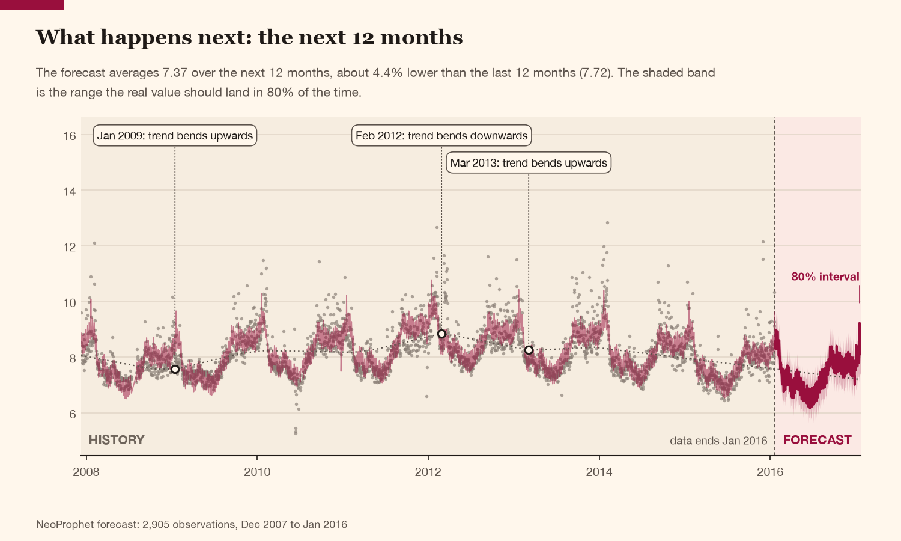
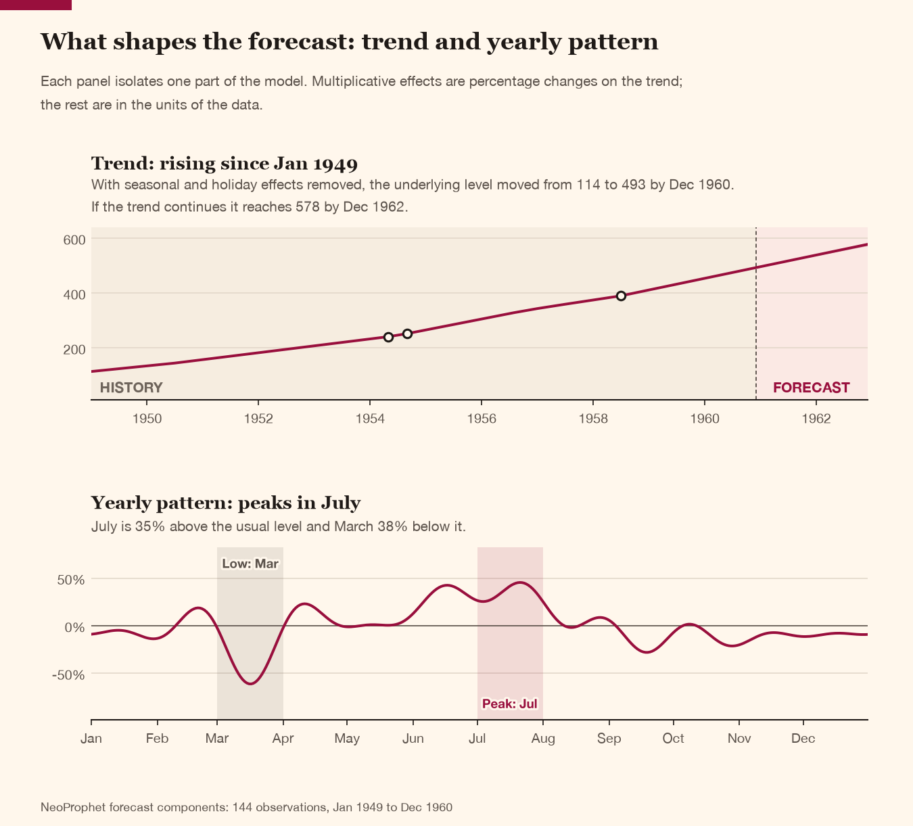
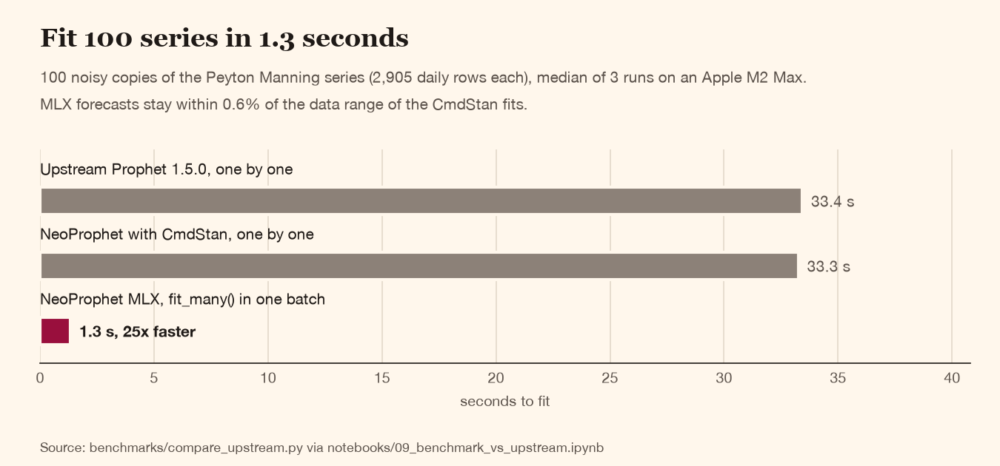

<div align="center">

# NeoProphet

**Prophet forecasting that is easier to use, clearer to read and faster at scale.**

A drop-in fork of [Facebook Prophet](https://github.com/facebook/prophet) with a one-call API, self-explaining charts, built-in tuning, an experimental Apple Silicon GPU backend and a Go service for high-throughput serving.

[](https://pypi.org/project/neoprophet/)


</div>



```python
import pandas as pd
from prophet import forecast

df = pd.read_csv("examples/example_wp_log_peyton_manning.csv")
result = forecast(df, horizon="12 months", country_holidays="US")
result.plot()   # the chart above, title and callouts included
```

## Why NeoProphet

Upstream Prophet is a great model with a dated developer experience. NeoProphet keeps the model and the API, and fixes the rest.

| | Upstream Prophet 1.5.0 | NeoProphet |
|---|---|---|
| **Forecast in one call** | `Prophet()`, `fit`, `make_future_dataframe`, `predict` | `forecast(df, horizon="12 months")` |
| **Input** | a DataFrame with `ds` and `y` columns | any date and value columns, a Series with a DatetimeIndex, timezone-aware dates, with clear errors for bad data |
| **Frequency** | you pass `freq` yourself | detected automatically, including irregular series |
| **Charts** | plain axes and a legend | data-derived titles, history and forecast zones, changepoint callouts, plain-English cross-validation labels |
| **Tuning** | write your own grid search | `forecast(..., tune=True)` or `prophet.tune(df)`, parallel cross-validation, plus an optional Optuna search (`tune="optuna"`) |
| **Regressors** | `add_regressor` plus building future frames by hand | `regressors=["promo"]`, validated future values, `weather="London"` for local temperature |
| **Closed days** | filter the future frame yourself; charts show empty gaps | `skip_days="weekends"`, `skip_hours=...`, gap-free charts |
| **Outputs** | forecast and components charts | plus backtest, regressor effects, one-page PDF report and offline HTML dashboard |
| **Many series** | fit them one by one | `fit_many()` fits 100 series in 1.3 s on an Apple Silicon GPU (experimental) |
| **Serving** | not included | Go REST service sharing the same Stan model |
| **Accuracy** | baseline | identical to upstream with default settings |

Existing code keeps working: `from prophet import Prophet` is unchanged, and the new chart options are opt-out.

## Install

```bash
pip install neoprophet            # or: uv add neoprophet
pip install "neoprophet[mlx]"     # adds the MLX backend on Apple Silicon
pip install "neoprophet[optuna]"  # adds Optuna hyperparameter search
```

NeoProphet installs the `prophet` import package, so it replaces upstream Prophet: uninstall `prophet` first and do not install both in one environment. Wheels include the compiled Stan model for macOS (Intel and Apple Silicon), Linux (x86-64 and ARM64) and Windows.

To track `main`, install from GitHub instead. This compiles the Stan model, which takes a few minutes and needs a C++ toolchain (Xcode Command Line Tools on macOS):

```bash
uv add "neoprophet @ git+https://github.com/CodeWithBehnam/NeoProphet#subdirectory=python"
```

## Feature tour

### Charts that explain themselves

Every chart says what it shows. Titles and subtitles come from the data (the peak month, the busiest weekday, how the forecast compares with the last period), the largest trend changes are called out, and multiplicative effects are shown as percentages.



```python
result = forecast(air_passengers, horizon="24 months", seasonality_mode="multiplicative")
result.plot_components()
```

The same style applies to `plot_cross_validation_metric` and to the plotly charts. Turn the extras off when you want a plain chart:

```python
m.plot(fcst, title=False, annotate=False)
```

### Tuning with one flag

```python
result = forecast(df, horizon="12 months", tune=True)
result.tuning.best_params   # chosen changepoint and seasonality prior scales, seasonality mode
result.tuning.scores        # every combination with its cross-validation metrics
```

Grid tuning searches 33 combinations in parallel and took 6 to 21 seconds per example dataset (about 2 minutes for 18,000 five-minute rows). Cross-validation only sees the past, so treat the result as a starting point: on the 8 example datasets it beat untuned Prophet defaults on 4 and was worse on 2, and hand-chosen settings still won on most. Check `result.tuning.scores` and a holdout before trusting it.

For continuous ranges instead of a fixed grid, `tune="optuna"` lets [Optuna](https://optuna.org) propose the combinations, informed by the scores of earlier trials. Optuna is an optional extra:

```bash
pip install "neoprophet[optuna]"
```

```python
result = forecast(df, horizon="12 months", tune="optuna")   # 40 trials over the default ranges
result.tuning.study   # the optuna.Study
```

To choose the space yourself, call `tune` with `search="optuna"`. Each value in `param_grid` is a `FloatRange`, an `IntRange` or a list of choices:

```python
from prophet import FloatRange, IntRange, tune

space = {
    "changepoint_prior_scale": FloatRange(0.001, 0.5, log=True),   # log=True samples on a log scale
    "n_changepoints": IntRange(10, 50),
    "seasonality_mode": ["additive", "multiplicative"],
}
result = tune(df, param_grid=space, search="optuna", n_trials=40)
result.best_params
result.study   # for Optuna's plots (needs plotly): optuna.visualization.plot_param_importances(result.study)
```

`n_trials` defaults to 40, and Prophet's defaults are scored as one extra run (`include_defaults=True`) so you can see what tuning gained. `timeout=` (seconds) stops proposing new trials once it has passed. `result.scores` gains `trial` and `pruned` columns. `prune=True` stops a trial partway through cross-validation when its score so far is worse than the median of completed trials at the same fold (from the second fold, once 5 trials have completed); it scores one trial at a time, so it needs `parallel=False`. In scripts, call `forecast` and `tune` under `if __name__ == "__main__":`, because tuning uses a process pool.

### Regressors, local temperature and skipped days

```python
result = forecast(
    sales,
    horizon="60D",
    regressors=["promo", "price"],     # columns in your data; future values via future=
    weather="Manchester",              # or (53.48, -2.24): daily temperature as a regressor
    skip_days="weekends",              # closed on Saturdays and Sundays
)
```

- `regressors=` takes column names, a dict of Series or a DataFrame, with `regressor_options=` for mode and prior scale. Missing future values fail with the exact timestamps that are missing.
- `weather=` fetches temperature for any place name or coordinates from [Open-Meteo](https://open-meteo.com) (free, no API key, cached on disk): recorded values for the history, the weather forecast for the next 16 days and, beyond that, the average for that day of year from the previous 5 years. Charts label which future values came from the forecast and which from climatology. Open-Meteo's free API is for non-commercial use; see its [terms](https://open-meteo.com/en/terms).
- `skip_days=` (`"weekends"`, `"Sat"`, `5`, ...) and, for sub-daily data, `skip_hours=` remove those periods from training, the forecast and every chart, so Friday joins Monday with no empty gap.

### Backtests, reports and dashboards

```python
result.plot_backtest()          # forecast against what actually happened on a held-out period
result.plot_regressor_effects() # how much each regressor moves the forecast, in plain words
result.report().savefig("forecast-report.pdf")   # one page: forecast, components, effects, accuracy
result.dashboard("forecast.html")                # interactive, self-contained, works offline
```

The dashboard needs plotly (`pip install plotly`). Beyond the forecast chart it holds a backtest and cross-validation accuracy by horizon, the trend with its changepoints and pace, seasonal heatmaps and strength, the effect of each holiday and regressor, residual diagnostics, data-quality checks with a downloadable forecast table, and the model settings in plain words with code to recreate the model. Choose and order the sections with `sections=`, and set the opening theme with `theme=`:

```python
from prophet.diagnostics import cross_validation

cv = cross_validation(result.model, initial="730 days", period="90 days", horizon="30 days")
result.dashboard(
    "forecast.html",
    theme="auto",                                       # "light", "dark" or "auto" (follow the system)
    sections=["forecast", "accuracy", "trend", "diagnostics", "settings"],
    cv=cv,                                              # adds error by horizon to the accuracy section
)
```

The keys, in their default order, are `forecast`, `accuracy`, `components`, `trend`, `seasonality`, `holidays`, `regressors`, `diagnostics`, `data` and `settings`. A section that does not apply, such as `holidays` for a model without any, is left out and logged at info level. A button on the page switches between the light and dark theme and remembers the choice in the browser. Skipped days and hours close up on every time axis.

The same functions are available for any fitted model in `prophet.visuals` (`dashboard_html(m, fcst, path, df=df, ...)`).

### Many series on an Apple Silicon GPU (experimental)



```python
from prophet.mlx_backend import fit_many

models = fit_many(list_of_dataframes)   # one batched optimisation on the GPU
forecasts = [m.predict(m.make_future_dataframe(30)) for m in models]
```

The MLX backend re-implements Prophet's MAP objective and solves many series at once. Forecasts stay within 0.6% of the data range of the CmdStan fits. It supports linear and flat growth (not logistic) and MAP only (no MCMC). For a single model use `Prophet(stan_backend="MLX")`; for small series such as Air Passengers (144 rows) and Retail Sales (293 rows), CmdStan is faster.

### Faster predictions

Predicting with uncertainty intervals is about 17% faster and cross-validation 13 to 22% faster than before, with bit-for-bit identical results for a fixed seed. Overall fit plus predict is within about 10% of upstream, because most of the time is spent inside CmdStan.

### Go service

The Go service wraps the same compiled Stan binary, reimplements data preparation and prediction maths in Go, and exposes a REST API. On the Peyton Manning dataset (2,905 daily observations):

| Metric | Python | Go | Speed-up |
|---|---:|---:|---:|
| Fit (mean) | 0.363 s | 0.252 s | **1.4x** |
| Predict (mean, 3,270 rows) | 0.181 s | 0.001 s | **199x** |
| Cross-validation (24 cutoffs) | 4.958 s | 0.482 s | **10.3x** |
| Cross-validation MAPE | 0.0548 | 0.0547 | **0.2% relative difference** |

```bash
# Compile the Stan model (one-time)
cd python && uv run python -c "from prophet.models import CmdStanPyBackend; CmdStanPyBackend().load_model()"

# Start the Go server
cd go
export PROPHET_STAN_BINARY=../python/prophet/stan_model/prophet_model.bin
go run ./cmd/server --http :8080
```

```bash
# Fit a model
curl -X POST http://localhost:8080/v1/fit \
  -H "Content-Type: application/json" \
  -d '{"ds": [1577836800, ...], "y": [9.59, ...], "config": {}}'

# Predict
curl -X POST http://localhost:8080/v1/predict \
  -H "Content-Type: application/json" \
  -d '{"model_id": "model-xxx", "periods": 365}'
```

| Endpoint | Method | Description |
|----------|--------|-------------|
| `/v1/fit` | POST | Fit a Prophet model, returns model ID and parameters |
| `/v1/predict` | POST | Generate forecasts from a fitted model |
| `/v1/cv` | POST | Run cross-validation with parallel cutoffs |
| `/v1/health` | GET | Service and Stan binary health check |

## Benchmarks against upstream Prophet

[`notebooks/09_benchmark_vs_upstream.ipynb`](notebooks/09_benchmark_vs_upstream.ipynb) runs NeoProphet and upstream Prophet 1.5.0 (from PyPI, in an isolated environment) through the same runner on the 8 example datasets, scoring each on a held-out final period. Apple M2 Max, median of 3 runs:

| Variant | Holdout accuracy against upstream | Fit and predict speed against upstream |
|---|---|---|
| NeoProphet, default settings | identical on all 8 datasets | 1.07x (within timing noise) |
| NeoProphet, `tune=True` | better on 2, worse on 5 against hand-chosen settings | tuning adds 6 to 21 s per dataset |
| NeoProphet, MLX backend | within about 5% RMSE on every dataset | 2.0x geometric mean, slower on the two smallest series |
| NeoProphet, MLX `fit_many()` on 100 series | within 0.6% of the data range | **25x** (1.3 s against 33.4 s) |

Regenerate the README charts from a benchmark run with `uv run python benchmarks/readme_charts.py --help`.

## Notebooks

A ten-part series that builds from a first forecast to production use. Every notebook uses the bundled example data, runs end to end in a few minutes and links to the next.

| # | Notebook | What you learn |
|---|----------|----------------|
| 00 | [Quick start](notebooks/00_quick_start.ipynb) | A forecast, its components and a report in one call |
| 01 | [Your data](notebooks/01_your_data.ipynb) | Input shapes, bad-data errors, frequencies and horizons, timezones, skipped days and hours |
| 02 | [Trend](notebooks/02_trend.ipynb) | Changepoints, saturating (logistic) growth, flat trends and one-off shocks |
| 03 | [Seasonality and holidays](notebooks/03_seasonality_and_holidays.ipynb) | Fourier order, custom and conditional seasonality, country and custom holidays, multiplicative mode |
| 04 | [Regressors and weather](notebooks/04_regressors_and_weather.ipynb) | Extra regressors, future values, local temperature with `weather=` |
| 05 | [Uncertainty and outliers](notebooks/05_uncertainty_and_outliers.ipynb) | Where intervals come from, checking coverage, handling outliers |
| 06 | [Evaluation and tuning](notebooks/06_evaluation_and_tuning.ipynb) | Backtests, cross-validation, metrics, and when tuning helps |
| 07 | [Reports and dashboards](notebooks/07_reports_and_dashboards.ipynb) | PDF reports, offline dashboards, saving, reloading and warm-starting models |
| 08 | [Many series on Apple Silicon](notebooks/08_many_series_mlx.ipynb) | Fitting many series at once with the MLX backend |
| 09 | [Benchmark against upstream](notebooks/09_benchmark_vs_upstream.ipynb) | NeoProphet against upstream Prophet on accuracy, speed, tuning and throughput |

## Development

The repository root is a uv workspace. `uv sync` creates `.venv`, installs the local `prophet` package in editable mode (compiling the Stan model on first install), the dev tools and, on Apple Silicon, the MLX extra.

```bash
git clone https://github.com/CodeWithBehnam/NeoProphet.git
cd NeoProphet
uv sync
uv run --directory python pytest prophet/tests
uv run --directory python pyrefly check prophet
```

Register the Jupyter kernel used by the notebooks:

```bash
uv run python -m ipykernel install --user --name neoprophet --display-name "NeoProphet (uv)"
```

Go:

```bash
cd go && go build ./... && go test ./...
```

## Architecture

```
python/
  prophet/
    quick.py            # forecast(): one-call API, input normalisation, frequency inference
    tuning.py           # tune(): parallel cross-validated hyperparameter search
    tuning_optuna.py    # Optuna search behind tune(search="optuna"), optional extra
    plot.py             # Default chart style (matplotlib and plotly), gap-free skip_axis()
    visuals.py          # Backtest, regressor effects, one-page report, HTML dashboard page and forecast section
    dashboard/          # Dashboard sections (accuracy, trend, seasonality, holidays, diagnostics, data, settings), shared style and palette
    weather.py          # Open-Meteo temperature: archive, forecast, climatology
    forecaster.py       # Core Prophet class: fit(), predict()
    models.py           # CmdStanPy backend (shells out to the Stan binary)
    mlx_backend.py      # Experimental MLX backend and batched fit_many()
    diagnostics.py      # cross_validation(), performance_metrics()
  stan/
    prophet.stan        # The Stan model (linear, logistic and flat trend)
go/
  cmd/
    server/             # HTTP service entrypoint
    bench/              # Single-dataset benchmark CLI
    bench_all/          # Multi-dataset benchmark CLI (JSON-driven)
  internal/
    cmdstan/            # exec.CommandContext wrapper and CSV parser
    prophet/            # Go Prophet: Fourier terms, changepoints, scaling, trend
    diagnostics/        # Parallel cross-validation via errgroup
    pool/               # Bounded-concurrency worker pool
  api/http/             # REST: /v1/fit, /v1/predict, /v1/cv, /v1/health
benchmarks/             # Upstream comparison runner, README chart generator, Python vs Go scripts
notebooks/              # Tutorial series 00 to 09 and helpers.py
examples/               # Example datasets (CSV)
R/                      # R package (CRAN-published upstream)
```

## How it works

Prophet decomposes a time series into trend, seasonality and holidays:

```
y(t) = g(t) + s(t) + h(t) + εₜ
```

- **g(t)**, trend: piecewise linear or logistic growth with automatic changepoints
- **s(t)**, seasonality: Fourier series for yearly, weekly and daily patterns
- **h(t)**, holidays: indicator functions for irregular events
- **εₜ**, error: normally distributed noise

Python and Go share the same Stan model for MAP estimation (L-BFGS, with a Newton fallback). The Go service reimplements data preparation and prediction maths natively; the optional MLX backend reimplements the MAP objective to fit many series in one batch.

### Key hyperparameters

| Parameter | Default | Effect |
|-----------|---------|--------|
| `changepoint_prior_scale` | 0.05 | Trend flexibility: higher allows more trend changes |
| `seasonality_prior_scale` | 10.0 | Seasonality strength: lower gives smoother seasonal patterns |
| `seasonality_mode` | additive | `multiplicative` when seasonal swings grow with the trend |
| `n_changepoints` | 25 | Number of potential changepoint locations |
| `growth` | linear | `logistic` for saturating growth, `flat` for no trend |

`tune=True` searches the first three for you over a fixed grid; `tune="optuna"` searches them over continuous ranges.

## References

- **Paper**: Taylor and Letham (2018). *Forecasting at Scale*. The American Statistician 72(1):37-45. [PeerJ Preprint](https://peerj.com/preprints/3190/).
- **Upstream repository**: [github.com/facebook/prophet](https://github.com/facebook/prophet)
- **Upstream documentation**: [facebook.github.io/prophet](https://facebook.github.io/prophet/)

## Licence

NeoProphet, like Prophet, is released under the [MIT licence](LICENSE). Prophet was created by Sean J. Taylor and Ben Letham at Facebook.
